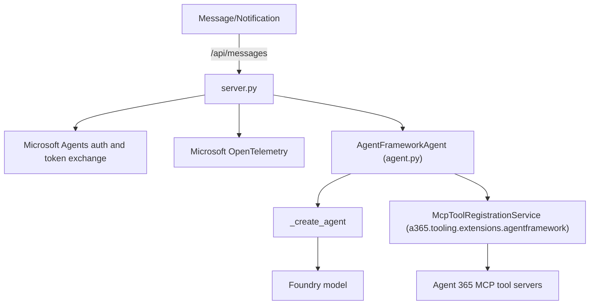
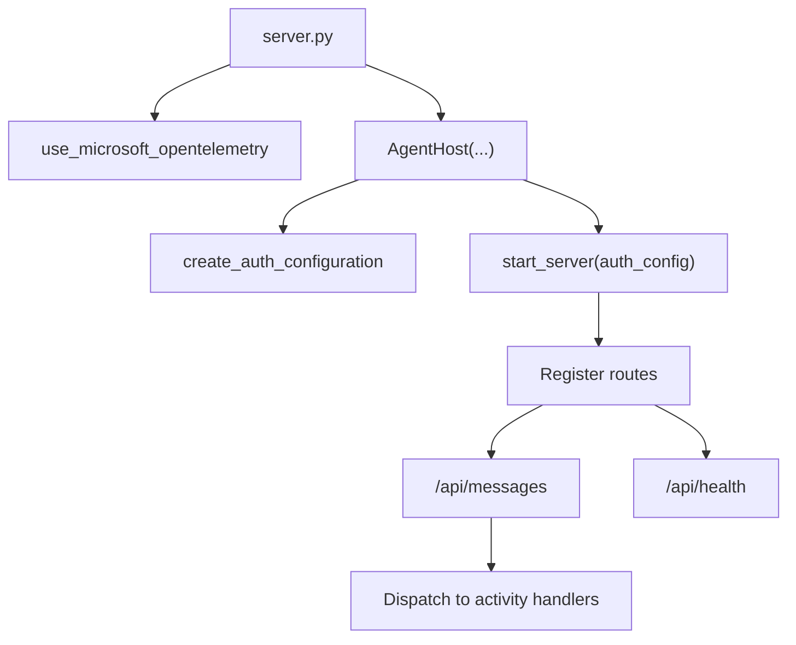
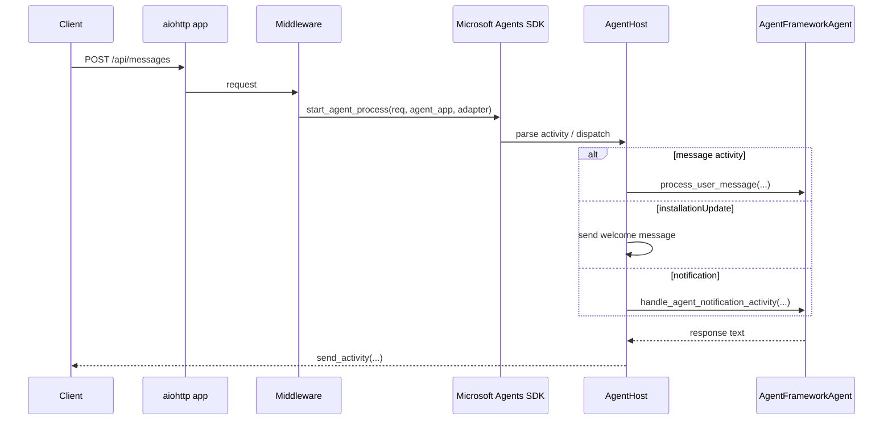
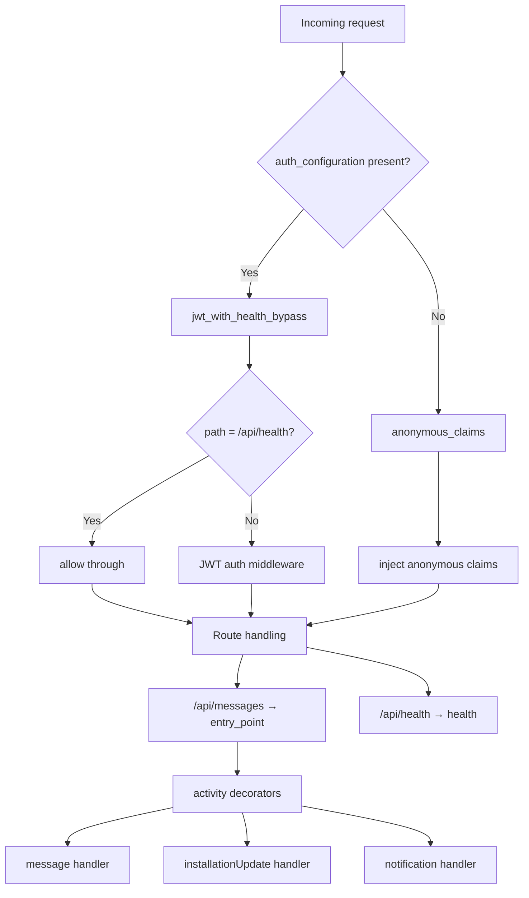

# Agent Framework sample agent

This is a Microsoft Agent Framework sample agent that:
- deploys in Azure Container Apps that uses a container image built with Python dependencies
- runs from application files under `/app` mounted from Azure Files for faster development iteration
- uses Foundry for model inference
- integrates with Microsoft Agent 365 SDK for wiring of notifications, MCP tooling and observability (via Microsoft OpenTelemetry)
- integrates with Microsoft Agents SDK for HTTP hosting, authentication, and notification routing

## 1. Overview



### 1.1. Startup flow



### 1.2. Request handling flow



### 1.3. Auth and route mapping



## 2. Files

### 2.1. Application (`/app`)

| Path | Purpose |
| --- | --- |
| `server.py` | Consolidated entrypoint and host.<br>Imports `AgentFrameworkAgent`, configures auth, activity handlers, notifications, health checks and observability, and starts the HTTP server. |
| `agent.py` | Agent Framework implementation.<br>Creates the Foundry chat client, wraps it in an Agent Framework agent, registers MCP tools, and processes messages and notifications. |

### 2.2. Container deployment

| Path | Purpose |
| --- | --- |
| `containerapp.yaml` | Azure Container Apps manifest template.<br>Values are substituted with `envsubst` before deployment. |
| `Dockerfile` | Multi-stage image that installs dependencies into a virtual environment and starts `server.py`. |
| `pyproject.toml` | Python package dependencies for this sample. |

## 3. Key concepts

## 3.1. Runtime flow

1. Azure Container Apps starts `python server.py`.
2. `main()` initializes Microsoft OpenTelemetry, constructs `AgentHost`, creates its authentication configuration, and starts the HTTP server.
3. `AgentHost` loads Microsoft Agents SDK configuration from environment variables, configures MSAL service connection authentication, registers message and notification handlers, and exposes `/api/messages` and `/api/health`.
4. On application startup, the host constructs `AgentFrameworkAgent`.
5. `AgentFrameworkAgent` creates a `FoundryChatClient` with the user-assigned managed identity, then creates an `agent_framework.Agent` with `AGENT_PROMPT` instructions.
6. The agent initially starts with no tools so the host can become healthy before the first authenticated turn.
7. On each user message or notification, `_setup_mcp_servers` exchanges an agentic token, discovers configured Agent 365 MCP tool servers, and recreates the Agent Framework agent with those tools attached.
8. User messages are processed with `self.agent.run(message)`.
9. Responses are converted to text by `_extract_result` and sent back through Microsoft Agents SDK.

### 3.2. Observability

Agent 365 observability is provided by Microsoft OpenTelemetry: https://github.com/microsoft/opentelemetry-distro-python/tree/main/src/microsoft/opentelemetry/a365

It is enabled just with a simple `use_microsoft_opentelemetry` ([example](https://github.com/microsoft/opentelemetry-distro-python/blob/main/samples/a365/exporter.py)):

```python
from microsoft.opentelemetry import use_microsoft_opentelemetry

use_microsoft_opentelemetry(
    enable_a365=True,
    a365_token_resolver=_observability_token_resolver,
)
```

The host exchanges an observability token for each message or notification and exposes it through the resolver while processing that turn.

The [documentation](https://github.com/microsoft/opentelemetry-distro-python/blob/main/A365_DOCUMENTATION.md) provides details on auto-instrumented libraries, baggage configuration, token resolver, etc

Microsoft OpenTelemetry replaces A365 observability and observability-extensions packages; the [migration documentation](https://github.com/microsoft/opentelemetry-distro-python/blob/main/MIGRATION_A365.md) provides more details.

### 3.3. `@web_middleware` paths

- If auth_configuration is present, the app uses `jwt_with_health_bypass`:
    - `/api/health` is allowed through
    - all other requests go through JWT authorization middleware
- If auth_configuration is absent, the app uses anonymous_claims:
    - it injects fake/anonymous claims so the request can still flow without JWT

### 3.4. MCP tool behavior

The sample uses `McpToolRegistrationService` from `microsoft_agents_a365_tooling_extensions_agentframework`. During each message or notification:

1. The agent exchanges an Agent 365 token using the configured auth handler.
2. Agent 365 tooling discovers tool server registrations for the deployed agent.
3. The service returns a new Agent Framework agent instance with MCP tools attached.
In `production`, tooling discovers the deployed MCP configuration. In development mode, the tooling package may attempt to read from `ToolingManifest.json`.

## 4. Required environment variables

| Variable | Required | Description |
| --- | --- | --- |
| `HOST` | No | HTTP bind host.<br>Defaults to `localhost`.<br>Use `0.0.0.0` for Azure Container Apps. |
| `PORT` | No | HTTP port.<br>Defaults to `3978`. |
| `FOUNDRY_PROJECT_ENDPOINT` | Yes | Foundry project endpoint. |
| `FOUNDRY_MODEL` | Yes | Foundry model deployment name. |
| `UAMI_CLIENT_ID` | Yes | Client ID of the UAMI used by `ManagedIdentityCredential`. |
| `PYTHON_ENVIRONMENT` | Yes | Set to `production` so Agent 365 tooling discovers deployed MCP tool configuration. |
| `ENABLE_OBSERVABILITY` | Recommended | Enables observability support. |
| `ENABLE_A365_OBSERVABILITY_EXPORTER` | Recommended | Enables Agent 365 observability exporter. |
| `AGENT_RUN_TIMEOUT_SECONDS` | Optional | Agent Framework runtime timeout. |
| `AGENT_PROMPT` | Optional | System instructions for the assistant.<br>Defaults to `You are a helpful assistant.` |
| `AUTH_HANDLER_NAME` | Yes | Set to `AGENTIC` for agentic user authorization token exchange flow. |
| `CONNECTIONS__SERVICE_CONNECTION__SETTINGS__*` | Yes | Configures agent blueprint as client ID and UAMI as FIC. |
| `CONNECTIONSMAP__0__*` | Yes | Maps all service URLs to `SERVICE_CONNECTION`. |
| `AGENTAPPLICATION__USERAUTHORIZATION__HANDLERS__AGENTIC__SETTINGS__*` | Yes | Configures agentic user authorization and Agent 365 scopes. |

### 4.1. Authentication and identity

This sample expects a user-assigned managed identity (UAMI) on the container app.

The UAMI is used for:

| Target | Required configuration |
| --- | --- |
| Azure AI Foundry | Assign `Cognitive Services User` to the Foundry account scope. |
| Azure Container Registry | Assign `AcrPull` to the registry scope. |
| Agent blueprint federated credentials | Create a federated credential on the blueprint app that trusts the UAMI principal ID. |
| Runtime model calls | Set `UAMI_CLIENT_ID` so `ManagedIdentityCredential` can authenticate the Foundry chat client. |

Agentic user authorization is enabled by setting `AUTH_HANDLER_NAME=AGENTIC`. MCP tooling and observability token exchange require this handler in the deployed configuration.

## 5. Deployment summary

The root [README.md](../README.md) contains the full Azure resource and Agent 365 setup. At a high level:

1. Create shared resources: resource group, Foundry resource and model deployment, storage account, Container Apps environment, and Azure Container Registry.
2. Set `SAMPLE='agent-framework'`.
3. Create a UAMI for this agent.
4. Grant the UAMI access to Foundry and ACR.
5. Create an Azure Files share named for the app and upload the files from `app`.
6. Build the image from this folder's `Dockerfile` and `pyproject.toml`.
7. Run `a365 setup all` with the container app messaging endpoint.
8. Configure MCP tools with `a365 develop add-mcp-servers`.
9. Grant MCP permissions with `a365 setup permissions mcp`.
10. Publish the Agent 365 manifest.
11. Substitute `containerapp.yaml` with environment variables and deploy it with `az containerapp create`.

### 5.1. Troubleshooting

| Symptom | Likely cause | Check |
| --- | --- | --- |
| `/api/health` returns `agent_initialized: false` | Agent failed during startup. | Inspect container logs for import, managed identity, or Foundry errors. |
| Model calls fail with authentication errors | UAMI is missing or lacks Foundry access. | Verify `UAMI_CLIENT_ID` and the `Cognitive Services User` role assignment. |
| MCP tools are not available | MCP permissions or tooling configuration is missing. | Run `a365 develop list-configured` and `a365 setup permissions mcp -n $APP_NAME`. |
| Token exchange is skipped | `AUTH_HANDLER_NAME` is unset. | Set `AUTH_HANDLER_NAME=AGENTIC` and ensure user authorization settings exist. |
| Container app cannot pull the image | UAMI lacks ACR pull permission or registry identity is wrong. | Verify `AcrPull` assignment and `${UAMI_RSC_ID}` in `containerapp.yaml`. |
| Health check fails in Azure Container Apps | App is not listening on the expected host or port. | Ensure `HOST=0.0.0.0`, `PORT=3978`, and ingress `targetPort` is `3978`. |
