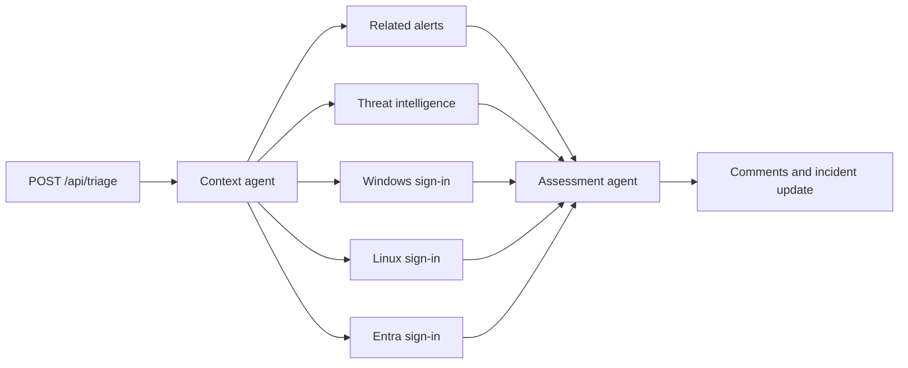

# AutoSOC LangGraph sample

AutoSOC accepts a Microsoft Sentinel playbook webhook, gathers a Defender incident,
runs five independent hunts, assesses the combined evidence, and writes the outcome
back to Microsoft Defender through Microsoft Graph.

## Workflow design



The outer `StateGraph` owns an `InMemorySaver` checkpointer. Each request receives a
unique thread ID, so context, all hunt reports, and the assessment are checkpointed
between nodes without mixing repeated runs for the same incident. Checkpoints are
intentionally lost when the replica restarts.

Agent responsibilities are deliberately narrow:

- The context agent calls only `get_incident_with_alerts` and emits validated structured data.
- Each hunting agent summarizes the result of one query and cannot choose or alter KQL.
- The assessment agent emits a structured classification and rationale.
- Workflow code constructs escaped KQL and performs comments and incident updates.

Keeping KQL in code instead of agent instructions prevents incident text from changing
query structure, makes conditional filters deterministic, and leaves the model focused on
evidence interpretation. The five hunt nodes run concurrently and use an explicit fan-in
barrier before assessment.

## Webhook

`POST /api/triage` expects JSON:

```json
{
  "incidentId": "12345"
}
```

After authentication and input validation, the service creates an in-process task and
immediately responds with `202 Accepted`:

```json
{
  "status": "accepted",
  "incidentId": "12345"
}
```

Duplicate requests for an incident already running also receive `202`, with
`"duplicate": true`. There is no status endpoint. Hunt summaries and the assessment are
written to Defender, while execution details and failures are written to Container Apps logs.

`GET /api/health` is unauthenticated and does not expose incident data.

## Authentication

The Microsoft Agents SDK JWT middleware validates the webhook bearer token's signature,
issuer, and audience. AutoSOC then checks the token's `azp` or `appid` claim against
`TRIAGE_ALLOWED_CALLER_APP_IDS`, which should contain the Logic App managed identity's
client ID. This prevents another identity with a token for the API from invoking triage.

Configure the Logic App HTTP action to:

1. Use `POST` and the JSON body shown above.
2. Use managed identity authentication.
3. Request audience `api://<BLUEPRINT_CLIENT_ID>`.
4. Call `https://<container-app-fqdn>/api/triage`.

The blueprint application must expose that Application ID URI and authorize the Logic App
managed identity. `TRIAGE_AUTH_SCOPE` is the corresponding
`api://<BLUEPRINT_CLIENT_ID>/.default` scope.

The outbound Graph client continues to use Microsoft Agents SDK
`get_agentic_user_token`. The Container App UAMI federates to the Agent Blueprint and
Agent User, then requests `https://graph.microsoft.com/.default`. Grant the Agent User:

- `SecurityIncident.Read.All`
- `SecurityIncident.ReadWrite.All`
- `ThreatHunting.Read.All`

## Configuration

The manifest expects these deployment substitutions in addition to the shared sample values:

| Variable | Purpose |
| --- | --- |
| `ASSIGNEE_IN_PROGRESS` | Owner for true-positive or suspicious incidents |
| `ASSIGNEE_RESOLVED` | Owner for false-positive or benign incidents |
| `LOGIC_APP_MI_CLIENT_ID` | Allowed Logic App managed identity client ID |
| `BLUEPRINT_CLIENT_ID` | Agent Blueprint and webhook API client ID |

Optional runtime settings include `HUNT_TIMESPAN` (default `P7D`),
`MAX_HUNT_RESULT_CHARS` (default `24000`), `INCIDENT_FETCH_ATTEMPTS` (default `5`),
and `INCIDENT_FETCH_DELAY_SECONDS` (default `15`). Threat intelligence always looks back
`P30D`.

## Deployment pattern

The Docker image installs all Python packages from `pyproject.toml`. Application files are
not copied into the image; `containerapp.yaml` mounts the Azure Files share at `/app`, and
the image starts `/app/server.py`. This preserves the existing sample development pattern.

Because accepted work is held only in the replica process, a scale-down, restart, or new
deployment can interrupt an active triage. The manifest keeps one replica running and limits
the app to one replica so in-memory deduplication and checkpoints remain coherent.